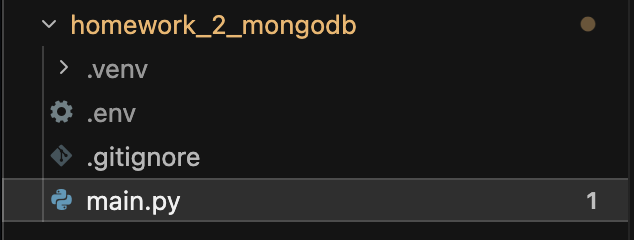
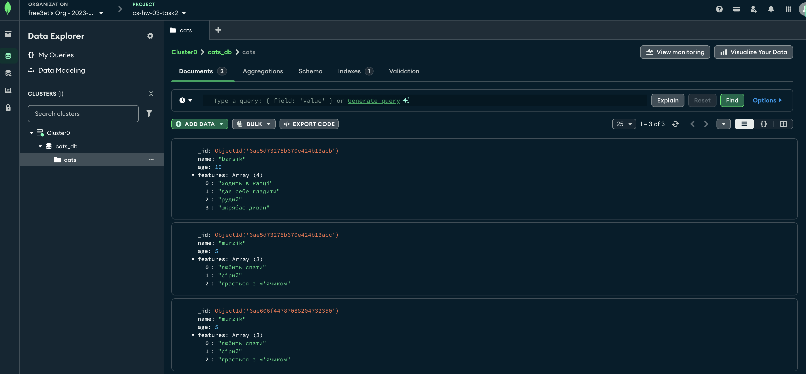

## Завдання 2. CRUD-операції з MongoDB (колекція котів)

Простий Python-застосунок для роботи з хмарною базою даних **MongoDB Atlas** через бібліотеку `pymongo`. Реалізує базові CRUD-операції над колекцією `cats` у базі даних `cats_db`.

## Структура документа

```json
{
  "_id": ObjectId("..."),
  "name": "barsik",
  "age": 3,
  "features": ["ходить в капці", "дає себе гладити", "рудий"]
}
```

| Поле       | Тип            | Опис                      |
|------------|----------------|---------------------------|
| `_id`      | ObjectId       | Унікальний ідентифікатор  |
| `name`     | string         | Ім'я кота                 |
| `age`      | int            | Вік кота                  |
| `features` | array[string]  | Характеристики кота       |

## Структура проєкту

```
homework_2_mongodb/
├── .env          # MONGO_URI (не потрапляє в git)
├── .gitignore
├── main.py       # основний скрипт
└── readme.md
```



## Встановлення та запуск

1. Створіть та активуйте віртуальне середовище:

   ```bash
   python3 -m venv .venv
   source .venv/bin/activate
   ```

2. Встановіть залежності:

   ```bash
   pip install pymongo python-dotenv certifi
   ```

3. Створіть файл `.env` у корені проєкту з рядком підключення до MongoDB Atlas:

   ```
   MONGO_URI=mongodb+srv://<user>:<password>@<cluster>.mongodb.net/?retryWrites=true&w=majority
   ```

   > Файл `.env` додано до `.gitignore`, щоб облікові дані не потрапили в репозиторій.

4. Запустіть скрипт:

   ```bash
   python main.py
   ```

## Функції

| Функція                              | Операція | Опис                                              |
|--------------------------------------|----------|---------------------------------------------------|
| `add_cat(name, age, features)`       | Create   | Додає одного кота                                 |
| `add_many_cats()`                    | Create   | Додає трьох котів (barsik, murzik, pushok)        |
| `show_all_cats()`                    | Read     | Виводить усіх котів з колекції                    |
| `find_cat_by_name(catname)`          | Read     | Знаходить і виводить кота за ім'ям                |
| `update_cat(catname, age)`           | Update   | Оновлює вік кота (`$set`)                         |
| `update_cat_features(catname, feature)` | Update | Додає нову характеристику до списку (`$push`)    |
| `delete_cat(catname)`                | Delete   | Видаляє кота за ім'ям                             |
| `delete_all_cats()`                  | Delete   | Видаляє всіх котів із колекції                    |

Усі функції обробляють винятки (`try/except`) і виводять зрозумілі повідомлення про помилки. З'єднання з базою закривається в блоці `finally`.

## Що робить `main.py` при запуску

1. Підключається до MongoDB та перевіряє з'єднання (`ping`).
2. Створює колекцію `cats`, якщо її ще немає.
3. Виводить усіх котів.
4. Знаходить кота `barsik`.
5. Змінює вік `barsik` на 10 та додає йому характеристику «шкрябає диван».
6. Видаляє кота `pushok`.

Виклики `add_many_cats()` та `delete_all_cats()` закоментовані — розкоментуйте їх за потреби (наприклад, `add_many_cats()` для початкового наповнення бази).

## Результат

Стан колекції `cats` у MongoDB Atlas після виконання скрипта:


